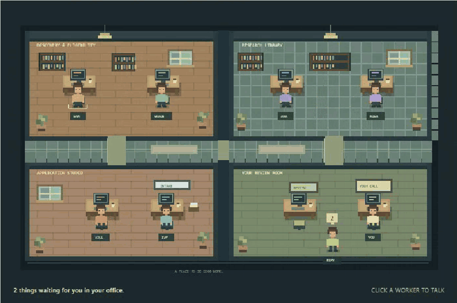
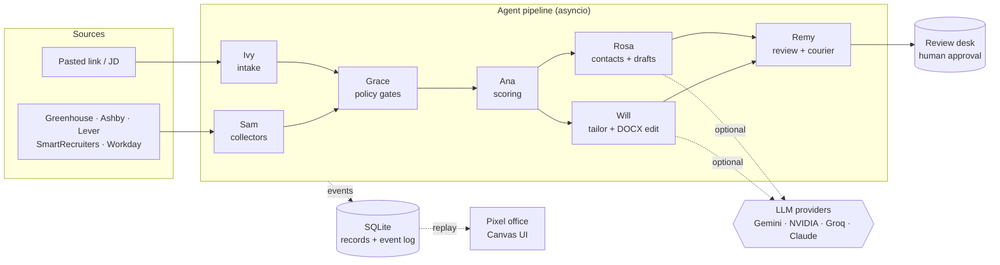
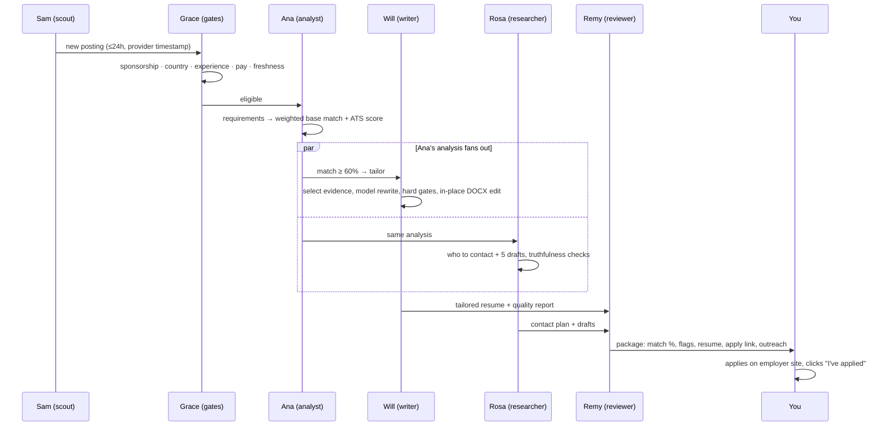

# Job Search Command Center

**A local-first, multi-agent system that finds fresh jobs, checks them against hard rules, tailors your own Word resume truthfully, plans outreach, and brings each finished package to a human review desk, shown as a pixel-art office.**


*Sample workspace: fictional jobs and resume. [Full-quality video](docs/demo/demo.mp4)*

Seven named agents share one pipeline. Every hour **Sam** collects new postings from 250 public company job boards. **Grace** applies the eligibility rules (sponsorship, country, experience, pay, freshness). **Ana** scores each role against the base resume. Then **Will** (resume) and **Rosa** (who to contact and what to say) work in parallel. **Remy** checks both and is the only agent who brings work to you. Nothing is ever submitted or sent: you download the resume, apply on the employer's site and click *I've applied*.

| | |
|---|---|
| **Stack** | Python 3.12, FastAPI, asyncio, SQLite, python-docx, vanilla JS + Canvas (no build step) |
| **Models** | Optional. Gemini Flash (free tier) by default, with NVIDIA / Groq / Claude behind the same interface. It runs fully without a model. |
| **Sources** | Greenhouse, Ashby, Lever, SmartRecruiters and Workday public APIs (250 verified boards) |
| **Runs** | Windows tray app with auto-start, a wake-from-sleep schedule, toast notifications and nightly backup |
| **Tests** | 96 (policy gates, truthfulness gates, DOCX editing, collectors, intake, LLM fallback, API) |

---

## The working floor



*Two sample jobs moving through the pipeline. The caption is the real event log ([video](docs/demo/floor.mp4)).*

The office is a **projection of the event log**, not a canned animation. Each agent writes events (`working`, `done`, `waiting`) to SQLite as it runs. The canvas replays them: an agent walks the work to the next desk, and anything that needs you is carried to your review room by Remy. Click any agent to chat with it ("why was this excluded?", "search now", "skip Acme").

| Agent | Role | Responsibility |
|---|---|---|
| Sam | Scout | Hourly collection from 250 boards, with catch-up after sleep or shutdown |
| Ivy | Intake | Turns a pasted job link or JD into a job (board APIs, then schema.org JobPosting, then page text) |
| Grace | Gatekeeper | Eligibility gates: sponsorship language, US location, 0–4 yrs, employment type, pay floor, 24h freshness |
| Ana | Analyst | Requirement extraction, weighted base-resume match, ATS keyword score, gaps |
| Will | Writer | Tailors the user's own .docx in place, then quality lint |
| Rosa | Researcher | Contact personas with search links, plus five outreach drafts (never sent) |
| Remy | Reviewer | Claim checks, then the single courier to the human |

---

## Architecture



### One job, end to end



### Architectural patterns

**1. Deterministic core, models at the edges ("models propose, validators decide").**
Gates, scores, selection and state are plain Python. A model is only asked to *rewrite* text that has already been chosen from verified evidence. Every proposed line goes through a fail-closed hard gate (`app/rules.py`):
- no number that isn't in the resume or career evidence
- no skill without evidence
- no inflating qualifiers ("real-time", "large-scale", "enterprise-grade") absent from the source
- no pronouns or template phrases, length caps
- no bullet that duplicates another

Failures fall back **per line** to the deterministic choice, so a bad model response degrades quality slightly and never truthfulness. Outreach drafts get the same treatment: a sentence written in the first person may only claim skills the candidate has shown, even when the job description mentions others.

**2. Fan-out / fan-in with a single courier.**
Ana's analysis is handed to Will and Rosa at the same time (`asyncio.gather`), and both results join at Remy. Only Remy writes to the human's inbox, so the UI has one owner for "things waiting on you" instead of seven agents competing for attention.

**3. Event log as the source of truth for the UI.**
Agents emit structured events into SQLite. The office canvas, activity feed and replay button are all projections of that log. The UI therefore can't drift from what actually happened, and any run can be replayed later at a watchable pace.

**4. Adapters + registry for job sources.**
Each ATS has a small adapter that normalises its schema into one `Job` shape. Adapters also encode **each provider's real timestamp semantics** (first published vs. updated vs. Workday's relative "posted yesterday") so freshness is never "first time we saw it". A seed registry of 250 boards verified live keeps discovery reproducible.

**5. Policy engine with explicit outcomes.**
Every gate returns `pass`, `review` or `excluded` with a human-readable reason. A high match score can't override an exclusion. Jobs the user brings in manually turn exclusions into **acknowledgement flags** that must be ticked before marking applied.

**6. Content-addressed packages and automatic invalidation.**
A package's id is a digest of everything that shaped it: job content hash, resume version, career-profile version, confirmed skills, relevant settings and a `TAILOR_VERSION`. If any of these change, the package is stale and is re-tailored on the next pass, while the user's own edits and outreach history are preserved when the context is unchanged.

**7. Edit the user's document, don't regenerate it.**
The base resume is the user's own .docx. Tailoring maps each line to a paragraph and applies **word-level diffs in place**, so fonts, tabs, section order and layout survive. A highlighted review copy and an HTML preview show exactly what changed. PDF export goes through Word itself.

**8. Provider abstraction with a privacy layer and fallback chain.**
`llm.complete_json(provider, system, prompt, schema)` is the only model entry point. It requests schema-constrained JSON and, for third-party models, **redacts identity** (name, email, phone, profile links become placeholders) and restores it afterwards. If a model is overloaded (503) or rate-limited (429), it tries the next Gemini model, then other configured free providers. Usage is logged as events so cost stays visible.

**9. Human-in-the-loop by construction.**
There is no code path that submits an application or sends a message. Chat commands are limited to search, tailor, skip and interval changes. The design target is "everything is ready when you sit down", not autonomy.

**10. Local-first operations.**
- Binds to localhost only.
- Heavy work runs off the event loop (`asyncio.to_thread`).
- Assessments are memoized.
- A tray process hosts the server.
- A scheduled task wakes the PC on AC power, runs a catch-up search sized to the time it was off (24–72h), then lets it sleep.
- SQLite is backed up nightly with the online-backup API.

---

## Truthfulness rules (what the system will not do)

| Rule | Where |
|---|---|
| Explicit sponsorship restriction ("no sponsorship", citizens only, clearance) → excluded, whatever the score | `policy.sponsorship` |
| Unstated sponsorship → allowed and labelled; conditional language → review | `policy.sponsorship` |
| Freshness uses each provider's real timestamps, never "first seen" | `policy.freshness` |
| Base match counts only base-resume facts; tailoring can't raise the gate score | `scoring.base_match` |
| Skills are added only with literal evidence; gaps are reported, never written in | `tailor.build_skills` |
| Model text with a new number, unsupported skill or inflated qualifier is rejected line by line | `rules.hard_gate` |
| Nothing is submitted or sent | `main.py`, `chat.py` |

Tailoring guidance is distilled from published recruiter and ATS research into 34 rules: [docs/TAILORING-RESEARCH.md](docs/TAILORING-RESEARCH.md).

## Scores

- **Base match**: weighted coverage of the job's recognised skills by verified resume facts (required ×2, mentioned ×1.5, preferred ×1). This is the gate: ≥60% tailor, 50–59% ask the human, <50% skip.
- **ATS keywords**: literal keyword coverage weighted by frequency, plus title alignment and parseability, shown before and after tailoring.
- **Priority**: match plus a recency bonus, so a strong role posted two hours ago rises to the top.

These are internal estimates, not an employer's ATS score.

---

## Run it

```bash
python -m venv .venv
.venv\Scripts\pip install -r requirements.txt
.venv\Scripts\python -m uvicorn app.main:app --port 8765
```

Open http://localhost:8765 and switch **Data → Sample workspace** to explore with fictional data, or upload your own .docx resume.

- **Background mode (Windows):** double-click `install.bat`. It adds desktop and Start-menu shortcuts, auto-start in the system tray, a scheduled "wake and search" task (every 2h on AC power), toast notifications and a nightly backup. Undo with `uninstall.bat`. Your data is kept.
- **Models (optional):** copy `.env.example` to `.env`, add `GEMINI_API_KEY` (free from Google AI Studio), and choose the provider in Preferences. `NVIDIA_API_KEY`, `GROQ_API_KEY` and `ANTHROPIC_API_KEY` also work. Keys never leave the server.
- **Career profile (optional):** import an "experience master dump" .docx on the *Career profile* page. It becomes a bullet bank, summary variants and evidence the writer can draw from.

### Tests and demo videos

```bash
.venv\Scripts\python -m pytest -q
.venv\Scripts\pip install -r requirements-dev.txt
.venv\Scripts\python -m playwright install chromium
.venv\Scripts\python docs/demo/record_demo.py     # demo.gif + demo.mp4
.venv\Scripts\python docs/demo/record_floor.py    # floor.gif + floor.mp4
```

The recorders start their own sample-only server with a temporary database and no API keys, so no real data can appear.

## Layout

```
app/
  main.py         FastAPI routes, runs, inbox actions, exports
  agents.py       the pipeline: Grace → Ana → (Will ∥ Rosa) → Remy
  collectors.py   Greenhouse / Ashby / Lever / SmartRecruiters / Workday adapters
  intake.py       Ivy: job link / pasted JD extraction
  policy.py       eligibility gates, freshness, priority
  scoring.py      requirement extraction, base match, ATS score
  tailor.py       evidence selection, model rewrite + validation, quality report
  docx_edit.py    in-place edits of the user's Word resume, highlighted copy, preview
  rules.py        research-backed lint and hard gates
  outreach.py     contact personas, template and model-written drafts
  career.py       career profile import and parsing
  llm.py          provider abstraction, redaction, fallback chain
  pipeline.py     what is waiting on the human and who brings it
  chat.py         talk to an agent
  scheduler.py    hourly scout, catch-up window, weekly report
  tray.py · wake.py · notify.py · backup.py   local background operation
  registry_seed.json   250 verified company boards
  static/         SPA + pixel office (Canvas)
docs/
  TAILORING-RESEARCH.md   the 34 tailoring rules and sources
  demo/                   README videos and their Playwright recorders
tests/            96 tests
```

User data lives in `data/` and keys in `.env`. Both are git-ignored.
